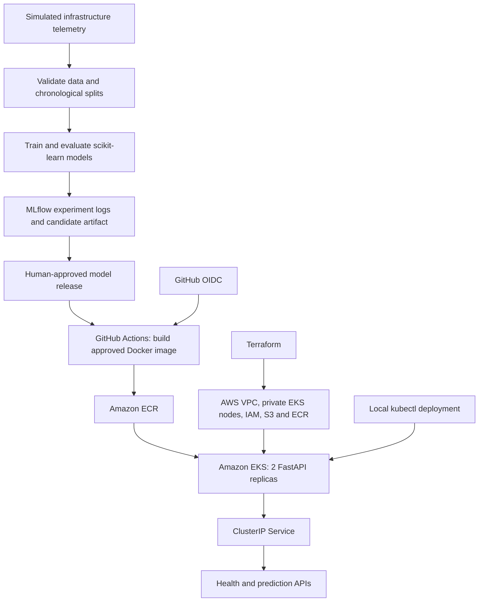

# Cloud Incident Prediction — MLOps on AWS

An end-to-end MLOps learning project that predicts whether an infrastructure incident may occur in the **next 30 minutes**, based on current telemetry. The project covers data generation, feature validation, scikit-learn training, MLflow experiment tracking, FastAPI inference, DevSecOps checks, model approval, Docker packaging, and deployment to **Amazon EKS**.

> **Project status (11 October 2026):** The approved model image was pushed to Amazon ECR and deployed successfully to EKS. Two API Pods were observed healthy on separate worker nodes; `/health` returned `{"status":"ok","model_loaded":true}`. Inference and rollback exercises were reported completed. The telemetry is **synthetic**: this is a demonstrator, not a validated production incident-prediction system.

## Architecture



**Security and deployment boundary:** GitHub Actions uses short-lived AWS credentials through OIDC to publish images to ECR. The EKS Kubernetes API is restricted to approved public IPs; deployment was performed with local `kubectl`. GitHub Actions is **not yet** an end-to-end automatic EKS deployment pipeline.

## Technology stack

| Layer | Technologies |
|---|---|
| Data and ML | Python, NumPy, pandas, scikit-learn, joblib |
| Experiment tracking | MLflow 3.x (training workflow currently uses runner-local SQLite) |
| Inference | FastAPI, Pydantic, Uvicorn |
| Packaging | Docker, Amazon ECR |
| Orchestration | Amazon EKS, Kubernetes |
| Infrastructure | Terraform, VPC, private subnets, IAM, S3 |
| Automation | GitHub Actions, GitHub OIDC |
| Quality and security | pytest, SonarQube/SonarCloud, Semgrep, Snyk, OWASP ZAP |

## Repository layout

```text
.
├── .github/workflows/
│   ├── ci.yaml                       # Tests and security gates
│   ├── train.yaml                    # Train and validate candidate models
│   ├── release.yaml                  # Human-reviewed model approval
│   └── build-approved-image.yml      # Package approved model and push to ECR
├── data/
│   └── generate_data.py
├── src/
│   ├── api.py                        # FastAPI /health and /predict
│   ├── preprocess.py                 # Feature validation and time-series splitting
│   └── train.py                      # Model training and MLflow logging
├── models/
│   └── incident_model.joblib
├── tests/
├── k8s/
│   ├── namespace.yaml
│   ├── deployment.yaml
│   └── service.yaml
├── infra/
│   ├── bootstrap/                    # Terraform remote-state bootstrap
│   └── terraform/                    # S3, ECR, VPC, EKS, IAM, OIDC
├── scripts/
├── Dockerfile
└── requirements-inference.txt
```

The standalone `build-approved-image.yml` workflow is currently in the repository. The intended later refactor is to consolidate image publication and deployment into the existing release workflow, without creating additional permanent pipelines.

## How the prediction works

The input comprises five features:

| Field | Type | Meaning |
|---|---|---|
| `cpu_usage_pct` | number, 0–100 | CPU utilization percentage |
| `memory_usage_pct` | number, 0–100 | Memory utilization percentage |
| `error_rate_pct` | number, 0–100 | Application error percentage |
| `p95_latency_ms` | nonnegative number | 95th-percentile request latency in milliseconds |
| `pod_restarts` | nonnegative integer | Pod restart count |

The target, `incident_next_30m`, equals `1` when a simulated incident occurs in the following **30 minutes** (excluding the current minute). The generator creates progressive degradation before incident events, rather than entirely random labels. Preprocessing sorts observations chronologically and uses a 30-minute gap between train/validation/test partitions to limit look-ahead leakage.

Training compares **Logistic Regression** and **Random Forest**. It selects a winner by validation F1, then average precision, and assesses it on a held-out chronological test set. MLflow logs model artifacts, parameters, and evaluation metrics; the winning classifier is also saved as `models/incident_model.joblib` for FastAPI inference.

> Model metrics on synthetic data do not establish performance on real EKS incidents. The running API is not connected to live CloudWatch or Prometheus telemetry.

## Run locally

Prerequisites: Python **3.13**, Git, and Docker. Commands below assume Git Bash in VS Code on Windows, or a compatible Bash shell.

```bash
# Clone your repository
git clone https://github.com/balasekhardevops-coder/cloud-incident-prediction.git
cd cloud-incident-prediction

# Create and activate a virtual environment
python -m venv .venv
source .venv/Scripts/activate   # Git Bash on Windows
 # source .venv/bin/activate     # Linux/macOS

# Install runtime and development dependencies
python -m pip install -r requirements-inference.txt
python -m pip install 'mlflow==3.16.1' skops pytest pytest-cov httpx
```

To generate and train a model, start MLflow in a **separate terminal**:

```bash
python -m mlflow server --backend-store-uri sqlite:///mlflow-local.db --host 127.0.0.1 --port 5443
```

Then in the original terminal:

```bash
export MLFLOW_TRACKING_URI=http://127.0.0.1:5443
python data/generate_data.py
python src/train.py
python -m pytest -v
python -m uvicorn src.api:app --host 127.0.0.1 --port 8000
```

The local MLflow server is for development. The existing training workflow uses its own temporary SQLite database and uploads experiment evidence as a GitHub artifact; a shared durable Registry has **not** been deployed.

## Test the API

```bash
curl -s http://127.0.0.1:8000/health
```

Expected shape:

```json
{"status":"ok","model_loaded":true}
```

Prediction request:

```bash
curl -s -X POST http://127.0.0.1:8000/predict \
  -H 'Content-Type: application/json' \
  -d '{
    "cpu_usage_pct": 85,
    "memory_usage_pct": 90,
    "error_rate_pct": 5.5,
    "p95_latency_ms": 1800,
    "pod_restarts": 3
  }'
```

The response contains `prediction` (`0` or `1`), `incident_probability` (between `0` and `1`), and `prediction_window_minutes` (`30`). Actual prediction values depend on the trained model.

## Docker

The Dockerfile uses Python 3.13, installs inference requirements, includes `src/api.py`, `src/preprocess.py`, and the trained joblib model, and runs Uvicorn as a non-root user on port `8000`.

```bash
docker build -t cloud-incident-api:local .
docker run --rm -p 127.0.0.1:8000:8000 cloud-incident-api:local
```

## AWS infrastructure

Terraform provisions a development VPC with private EKS worker nodes across two Availability Zones, ECR for container images, S3 for artifacts, and IAM/OIDC access. Its state is stored in a separately bootstrapped S3 backend.

- **AWS Region:** `ap-south-1`
- **AWS account:** `758854589827` (project-specific example; use your own account for forks)
- **EKS cluster:** `cloud-incident-prediction-dev-eks`
- **ECR repository:** `cloud-incident-prediction-dev`
- **Kubernetes namespace:** `incident-prediction`
- **Kubernetes Deployment and Service:** `incident-api`

See [`infra/terraform/BACKEND_SETUP.md`](infra/terraform/BACKEND_SETUP.md) and [`infra/terraform/README.md`](infra/terraform/README.md) before running Terraform. **Do not commit state files, `.tfvars` containing sensitive values, credentials, or local model-approval downloads.** Review `terraform plan` before applying; EKS nodes and NAT gateways incur costs.

## CI, training, approval, and image publishing

| Workflow | Trigger | Purpose |
|---|---|---|
| `ci.yaml` | Push, pull request, manual | Unit tests, quality and security checks |
| `train.yaml` | Manual | Generate data, train models, validate thresholds, save candidate/evidence |
| `release.yaml` | Manual with training run ID | Validate candidate provenance and require independent approval before publishing an approved artifact |
| `build-approved-image.yml` | Manual with successful release run ID | Validate the approved release, replace the model in the Docker build context, authenticate via OIDC, and push an immutable ECR image |

The standalone image-publishing workflow remains in place for the current implementation. **Do not confuse approval with automatic deployment:** approved models are not deployed simply by running `release.yaml`.

A verified successful approved-model image build was recorded in GitHub Actions [run 38120040061](https://github.com/balasekhardevops-coder/cloud-incident-prediction/actions/runs/38120040061), based on model approval [run 38052793010](https://github.com/balasekhardevops-coder/cloud-incident-prediction/actions/runs/38052793010).

## Deploy to EKS

First configure AWS CLI access and the appropriate EKS context:

```bash
aws sts get-caller-identity
aws eks update-kubeconfig --name cloud-incident-prediction-dev-eks --region ap-south-1
kubectl get nodes -o wide
```

A successfully built approved image used this tag:

```text
758854589827.dkr.ecr.ap-south-1.amazonaws.com/cloud-incident-prediction-dev:release-38052793010-baae46647050ae5f4bbe804c6e0833c421d5d2f6
```

Use the image approved for your deployment, not necessarily that historical tag. The base `k8s/deployment.yaml` contains the `REPLACE_IMAGE_URI` placeholder and must be populated before initial apply.

```bash
export IMAGE_URI='758854589827.dkr.ecr.ap-south-1.amazonaws.com/cloud-incident-prediction-dev:release-38052793010-baae46647050ae5f4bbe804c6e0833c421d5d2f6'

kubectl apply -f k8s/namespace.yaml
kubectl apply -f k8s/service.yaml
sed "s|REPLACE_IMAGE_URI|$IMAGE_URI|g" k8s/deployment.yaml | kubectl apply -f -
kubectl rollout status deployment/incident-api -n incident-prediction --timeout=300s
kubectl get pods -n incident-prediction -o wide
kubectl get svc -n incident-prediction
```

**Production hardening:** pin images by ECR SHA-256 digest, retain release provenance, and use a protected deployment mechanism with private Kubernetes API connectivity.

### Reach the private application

The Kubernetes Service is `ClusterIP`, not a public internet endpoint. Use port-forwarding:

```bash
kubectl port-forward -n incident-prediction service/incident-api 8050:80
```

In another terminal:

```bash
curl -s http://127.0.0.1:8050/health
curl -s -X POST http://127.0.0.1:8050/predict \
  -H 'Content-Type: application/json' \
  -d '{"cpu_usage_pct":85,"memory_usage_pct":90,"error_rate_pct":5.5,"p95_latency_ms":1800,"pod_restarts":3}'
```

### Rollout and rollback

```bash
kubectl rollout history deployment/incident-api -n incident-prediction
kubectl rollout status deployment/incident-api -n incident-prediction
# If a newer revision is unhealthy and a prior revision exists:
kubectl rollout undo deployment/incident-api -n incident-prediction
```

Always check the Deployment's image and smoke-test `/health` and `/predict` after a rollback. Rolling back a Deployment does not independently validate the statistical quality of a model.

## Implementation progress

| Tasks | Status |
|---|---|
| 1–7: Local ML, API, tests, Docker | Completed |
| 8–11: GitHub CI, continuous training, approval | Completed |
| 12–14: AWS S3/ECR, VPC/EKS/IAM, GitHub OIDC | Completed |
| 15: Push approved Docker image to ECR and deploy to EKS | Completed |
| 16: API inference and Kubernetes rollback exercise | Reported completed |
| 17: Live CloudWatch/Prometheus telemetry integration | **Skipped** |
| 18: Persistent MLflow Model Registry | **Skipped** |
| 19: Monitoring, drift detection, automated retraining | **Not implemented** |

## Known limitations and next improvements

- The classifier is trained and evaluated on **simulated** incidents; real-world generalization and alert-quality are unknown.
- The live API receives manually submitted metrics; it does not ingest CloudWatch or Prometheus measurements automatically.
- The training workflow's MLflow tracking database is temporary, not a persistent centrally managed model registry.
- Image publication and EKS deployment are still separate operational steps; deployment is not yet integrated into the human-approved release workflow.
- Production-grade monitoring, model-drift detection, alerting, and retraining orchestration are not implemented.
- The current cluster incurs AWS charges even when there are no API requests.

## References

- [GitHub Actions runs](https://github.com/balasekhardevops-coder/cloud-incident-prediction/actions)
- [MLflow documentation](https://mlflow.org/docs/latest/)
- [Amazon EKS documentation](https://docs.aws.amazon.com/eks/)
- [Terraform AWS provider](https://registry.terraform.io/providers/hashicorp/aws/latest/docs)

## License

No license is declared in this README. Consult the repository for a license file before reusing the code outside this project.
